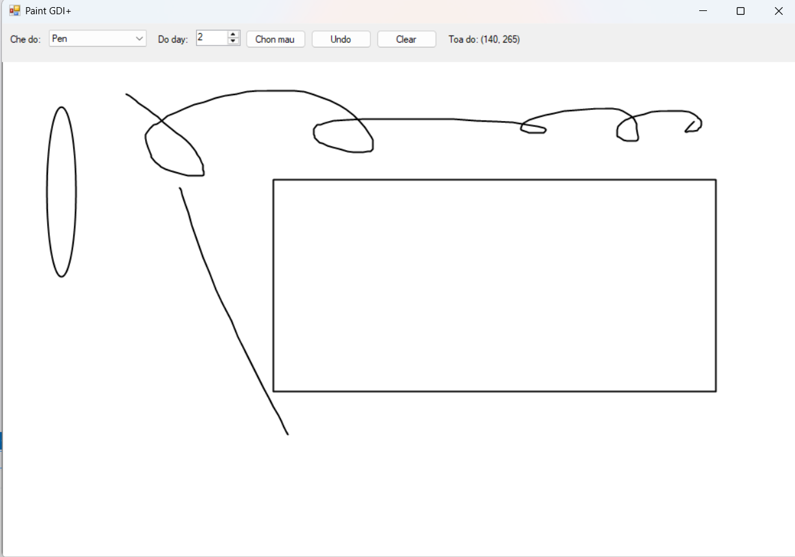
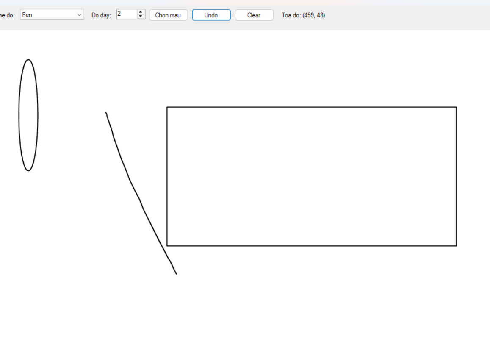
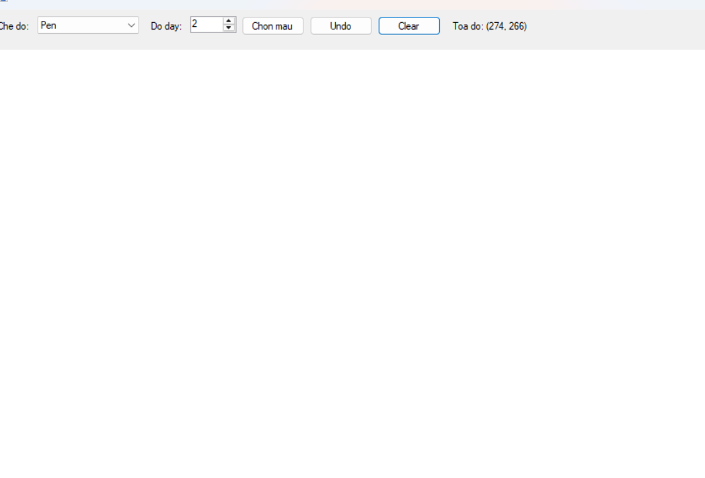
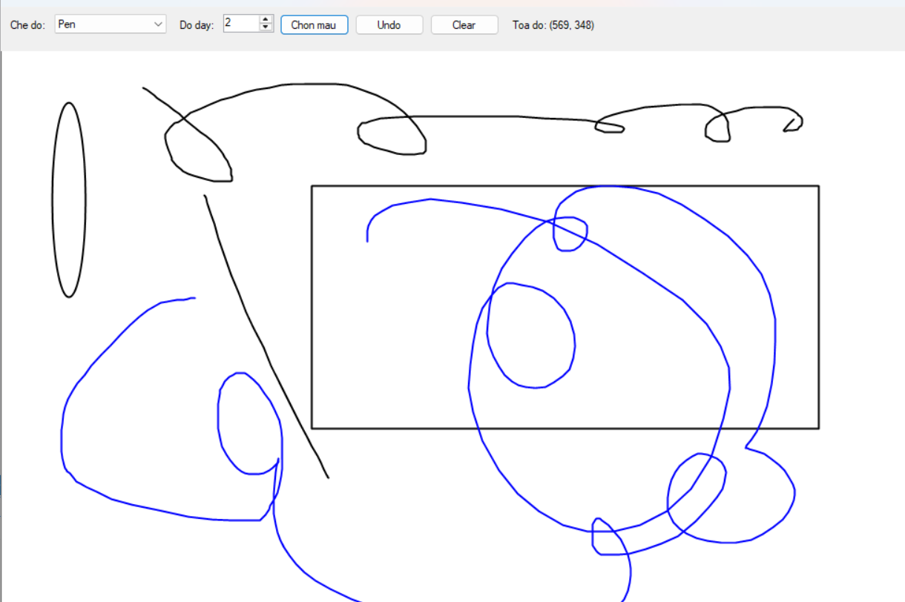

# LAB 08 - XÂY DỰNG ỨNG DỤNG PAINT ĐƠN GIẢN BẰNG WINFORMS VÀ GDI+

## 1. Giới thiệu tổng quan

Ứng dụng **COMP1019_Lab08_SimplePaint** được xây dựng bằng ngôn ngữ C# trên nền tảng Windows Forms. Chương trình sử dụng thư viện đồ họa **GDI+** để vẽ các hình họa tương tác trực tiếp bằng chuột. Toàn bộ hình vẽ được lưu trữ trong danh sách đối tượng `List<DrawItem>` và quản lý vẽ lại thông qua sự kiện `Paint` của Canvas, đảm bảo dữ liệu nét vẽ không bị mất khi thu nhỏ hoặc thay đổi kích thước Form.

---

## 2. Danh sách Control và Cấu trúc Giao diện

Giao diện chương trình được thiết kế trực quan với các vùng làm việc chính:

### 2.1. Thanh công cụ điều khiển (Top Panel)

- **`cboMode`** (ComboBox): Lựa chọn các chế độ vẽ: `Pen` (tự do), `Line` (đường thẳng), `Rectangle` (hình chữ nhật), `Ellipse` (hình elip).
- **`nudWidth`** (NumericUpDown): Điều chỉnh độ dày nét vẽ trong khoảng từ 1 đến 20 pixel.
- **`btnColor`** (Button): Mở hộp thoại `ColorDialog` để tùy chọn màu vẽ.
- **`btnUndo`** (Button): Xóa nét vẽ vừa thao tác gần nhất.
- **`btnClear`** (Button): Xóa toàn bộ nội dung hiện có trên vùng vẽ.

### 2.2. Vùng vẽ chính & Thanh trạng thái

- **`canvas`** (Panel): Vùng vẽ trung tâm nền trắng, xử lý các sự kiện chuột `MouseDown`, `MouseMove`, `MouseUp` và `Paint`.
- **`lblStatus`** (ToolStripStatusLabel): Hiển thị tọa độ con trỏ chuột (X, Y) theo thời gian thực.

---

## 3. Danh mục chức năng của chương trình

|  STT  | Chức năng              | Mô tả chi tiết                                                         |
| :---: | :--------------------- | :--------------------------------------------------------------------- |
| **1** | Vẽ Pen tự do           | Cho phép di chuyển chuột vẽ đường cong liên tục.                       |
| **2** | Vẽ Line                | Kéo thả chuột để tạo đường thẳng giữa 2 điểm.                          |
| **3** | Vẽ Rectangle & Ellipse | Tính toán khung hình chữ nhật/elip chuẩn xác theo mọi hướng kéo chuột. |
| **4** | Chọn màu & Độ dày      | Thay đổi màu bằng `ColorDialog` và độ dày bằng `NumericUpDown`.        |
| **5** | Undo & Clear           | Khôi phục nét vẽ gần nhất hoặc xóa sạch dữ liệu trên Canvas.           |

---

## 4. Hướng dẫn cài đặt và chạy ứng dụng

1. Khởi động **Visual Studio 2022/2026**.
2. Mở file solution (`COMP1019_Lab08_SimplePaint.sln`).
3. Nhấn phím **F5** (hoặc **Ctrl + F5**) để biên dịch và chạy ứng dụng.
4. Chọn chế độ vẽ, điều chỉnh nét và vẽ trực tiếp bằng chuột trái trên vùng canvas.

---

## 5. Kết quả thực nghiệm và Minh họa chức năng

1. Minh họa thao tác vẽ Pen, Line, Rectangle, Ellipse và tô màu khối:

2. Undo

3. Clear:

4. Vẽ màu:

