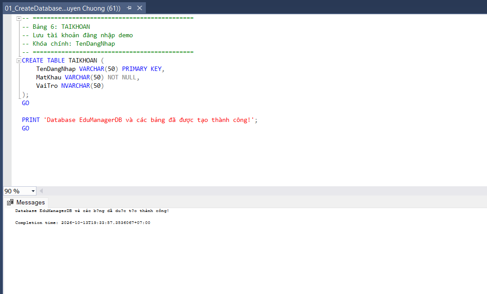
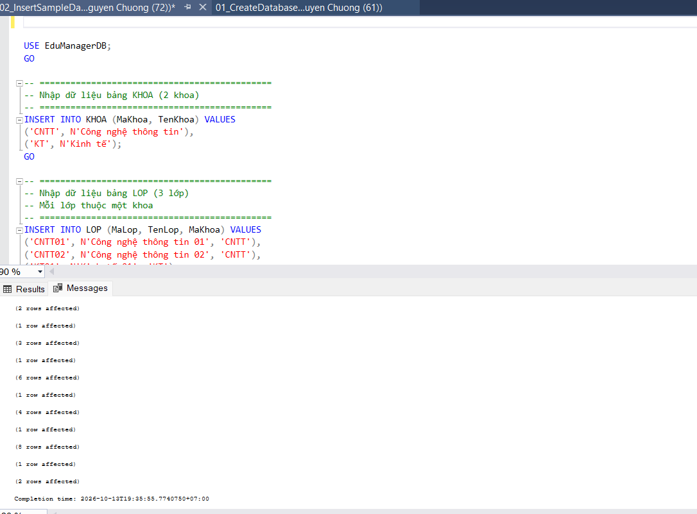
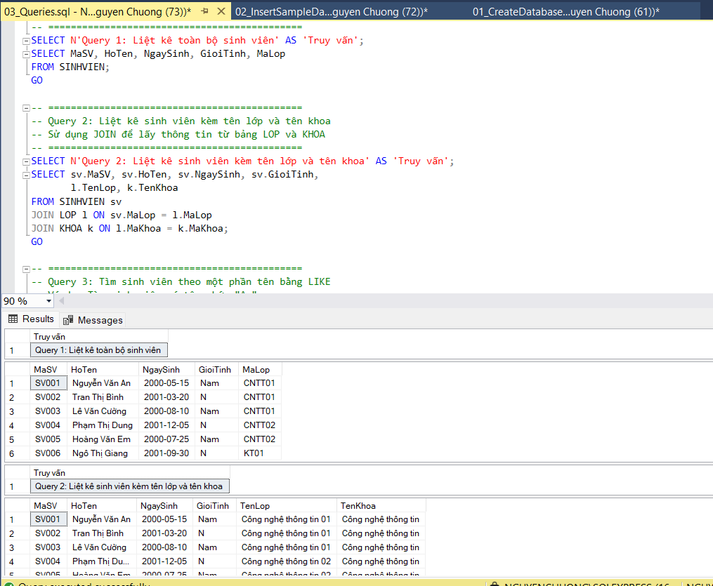

# Lab 10 - Thiết kế và cài đặt cơ sở dữ liệu EduManagerDB bằng SQL Server

## 1. Mục tiêu bài thực hành

- Thiết kế cơ sở dữ liệu quan hệ cho bài toán quản lý sinh viên.
- Tạo database, bảng, khóa chính, khóa ngoại và ràng buộc bằng T-SQL.
- Nhập dữ liệu mẫu đúng quan hệ giữa các bảng.
- Viết các truy vấn SELECT, JOIN, GROUP BY, UPDATE và DELETE.
- Kiểm thử ràng buộc dữ liệu bằng các trường hợp nhập sai.

---

## 2. Mô tả bài toán

Xây dựng cơ sở dữ liệu EduManagerDB cho ứng dụng quản lý sinh viên. Cơ sở dữ liệu cần quản lý các thông tin: khoa, lớp, sinh viên, môn học, kết quả học tập và tài khoản đăng nhập.

---

## 3. Hình ảnh chạy thử

### Bước 1: Tạo database và bảng

Chạy file `01_CreateDatabase.sql` trong SQL Server Management Studio (SSMS):

### Bước 2: Nhập dữ liệu mẫu

Chạy file `02_InsertSampleData.sql` sau khi đã tạo database:

### Bước 3: Chạy các truy vấn

Chạy file `03_Queries.sql` để kiểm tra các truy vấn:

