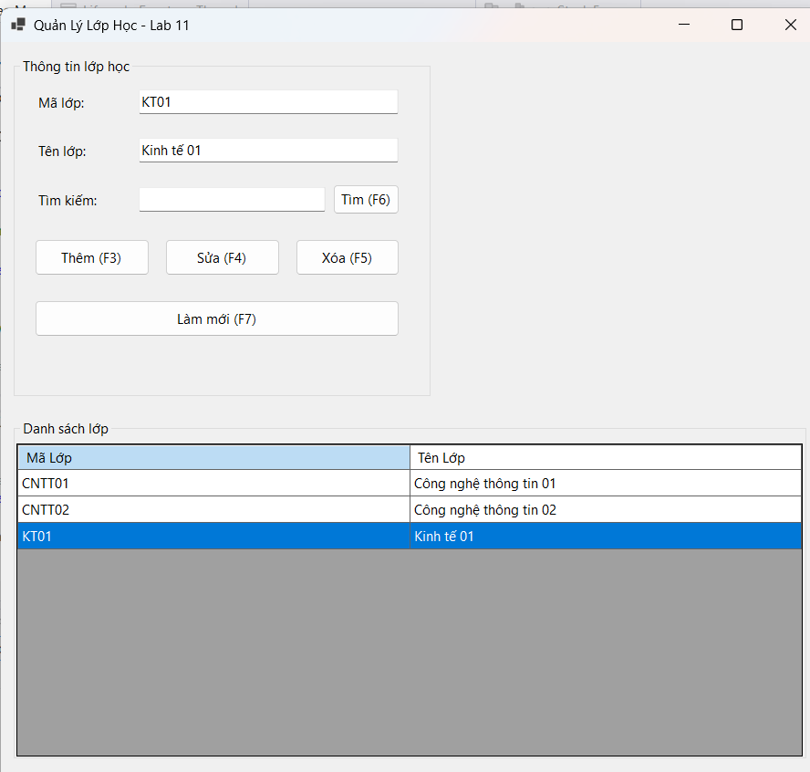
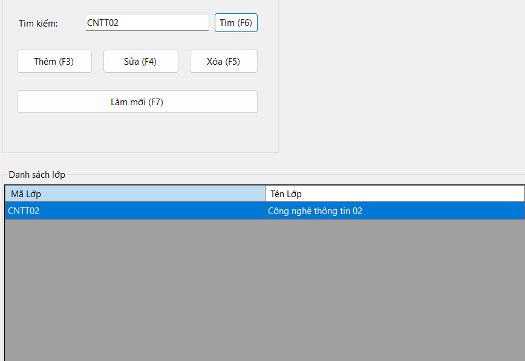
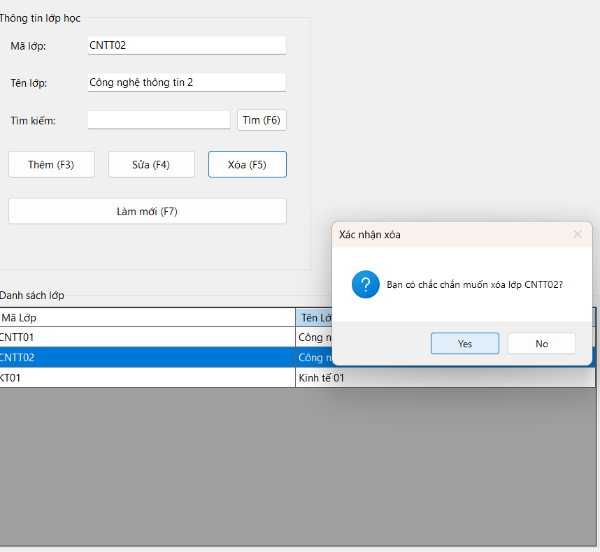
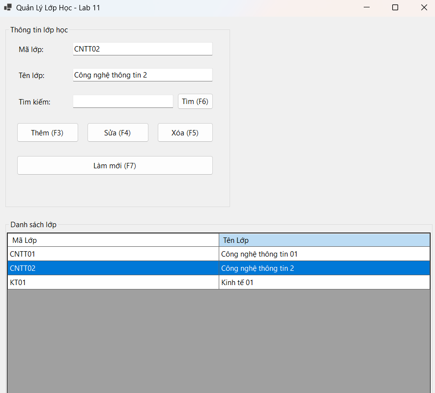
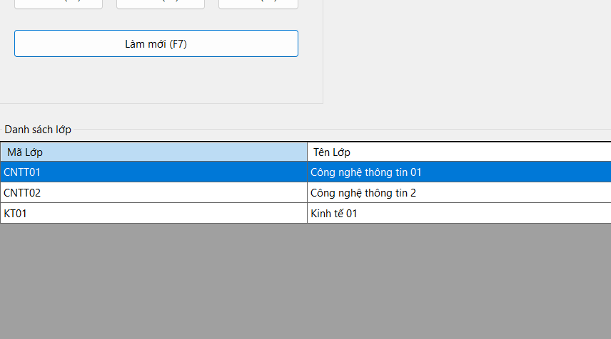

# Lab 11 - ADO.NET và CRUD với SQL Server

## 1. Mục tiêu bài thực hành

- Kết nối ứng dụng Windows Forms với database EduManagerDB trong SQL Server.
- Hiển thị dữ liệu từ bảng LOP lên DataGridView.
- Thực hiện thêm, sửa, xóa và tìm kiếm lớp học bằng câu SQL có tham số.
- Kiểm tra dữ liệu nhập, kiểm tra trùng mã lớp và xử lý lỗi khóa ngoại khi xóa.
- Viết code rõ ràng, có tách hàm xử lý cơ bản để kiểm thử.

---

## 2. Yêu cầu chuẩn bị

- Hoàn thành database EduManagerDB của buổi 10.
- Database phải có tối thiểu hai bảng LOP và SINHVIEN.
- Bảng SINHVIEN có khóa ngoại MaLop tham chiếu đến bảng LOP.
- Tạo project Windows Forms App bằng C#.
- Cài package Microsoft.Data.SqlClient nếu project chưa có thư viện kết nối SQL Server.

---

## 3. Mô tả bài toán

Sinh viên xây dựng Form quản lý lớp học. Dữ liệu lớp học được lưu trong SQL Server, không lưu tạm bằng List<T>.

---

## 4. Hướng dẫn biên dịch và kiểm thử

### Bước 1: Tạo database

Chạy các file SQL từ Lab10 theo thứ tự:

1. `01_CreateDatabase.sql`
2. `02_InsertSampleData.sql`

### Bước 2: Cấu hình Connection String

Mở file `FrmClassManager.cs` và thay đổi `connectionString` theo cấu hình SQL Server của bạn. 3. private readonly string connectionString = "Server=NGUYENCHUONG\\SQLEXPRESS;Database=EduManagerDB;Integrated Security=True;TrustServerCertificate=True;";

## 5. Hình ảnh chạy thử

1. Thêm
   

2. Tìm

 3. Sửa

4. Làm mới
   
